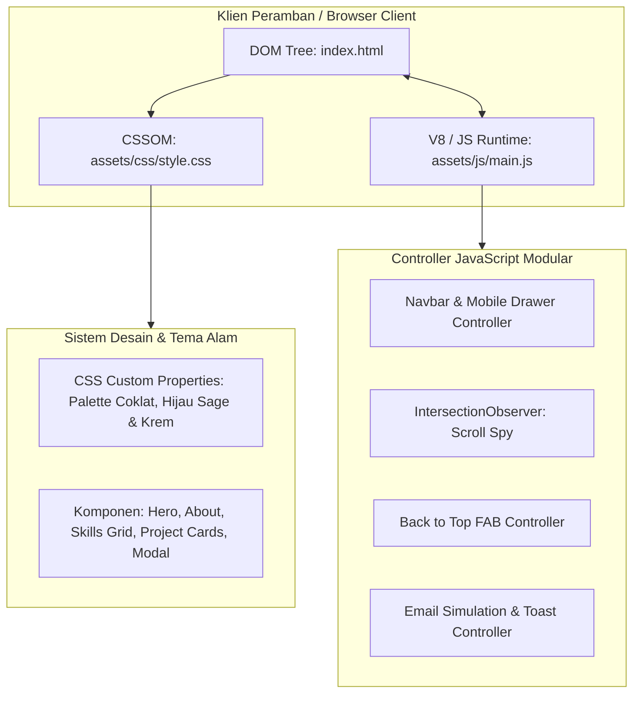
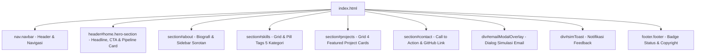
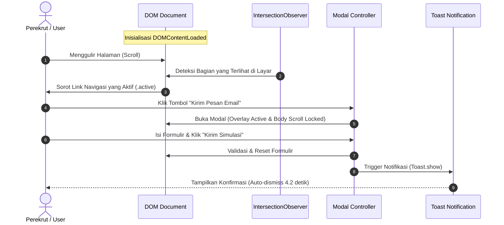

# 🌿 Arsitektur Perangkat Lunak: Website Portofolio Backend Developer

Dokumen ini menjelaskan arsitektur teknis, struktur direktori, prinsip pemisahan tanggung jawab (*Separation of Concerns*), sistem token desain, dan alur kerja runtime dari kode portofolio yang telah dibangun.

---

## 1. Prinsip Utama & Filosofi Arsitektur

Arsitektur website ini dibangun dengan standar rekayasa perangkat lunak modern untuk seorang **Backend Developer / Software Engineer**, dengan prinsip:

1. **Zero-Dependency Footprint**:
   - Berjalan murni menggunakan HTML5 Semantik, CSS3 Native, dan Vanilla JavaScript (ES6+).
   - Tidak memerlukan *build tool* (seperti Webpack/Vite) atau *runtime manager* (npm/Node.js), sehingga website dapat langsung di-hosting di GitHub Pages, Vercel, Netlify, Nginx, atau dibuka langsung via protokol lokal `file:///`.
2. **Separation of Concerns (SoC)**:
   - **Markup & Struktur**: Terisolasi di `index.html`.
   - **Presentasi & Desain Sistem**: Terisolasi di `assets/css/style.css`.
   - **Logika & Interaktivitas DOM**: Terisolasi di `assets/js/main.js`.
3. **High Performance & 60 FPS UI**:
   - Menggunakan `IntersectionObserver API` untuk *scroll spy* daripada event *scroll listener* berat yang menyebabkan *layout thrashing*.
   - Menggunakan *CSS hardware-accelerated transforms* (`translateY`, `scale`, `opacity`) untuk animasi dan transisi hover.
4. **Strict Identity Alignment**:
   - Menonjolkan persona backend: arsitektur sistem berlapis, kehandalan alur data, basis data relasional, dan penyelesaian logika tingkat tinggi.

---

## 2. Struktur Direktori Proyek

```text
CDP_E-BIO/
├── index.html              # Entry Point: Struktur semantik single-page & modal
├── assets/
│   ├── css/
│   │   └── style.css       # Design Tokens, Utility, Layout, & Component Styles
│   └── js/
│       └── main.js         # Modular Controller, Observer, & Event Listeners
└── ARCHITECTURE.md         # Dokumentasi arsitektur teknis sistem
```

---

## 3. Diagram Arsitektur Tingkat Tinggi



---

## 4. Arsitektur Komponen Antarmuka (HTML Semantik)

Halaman ini mengadopsi hierarki komponen linier (*single-page layout*) dengan landmark semantik HTML5 standar:



### Rincian Bagian & Peran Data:
| Bagian | Elemen Semantik | Tanggung Jawab Teknis |
| :--- | :--- | :--- |
| **Navbar** | `<nav class="navbar">` | Menampilkan brand identitas, link navigasi dinamis, dan hamburger mobile. |
| **Hero** | `<header class="hero-section">` | *First impression recruiter*: Headline backend, tagline, CTA cepat, dan diagram visual *system architecture layer*. |
| **About Me** | `<section id="about">` | Narasi profil spesifik (pendidikan Informatika, Linux Ubuntu harian, Laravel 12, ASP.NET, Python). |
| **Skills** | `<section id="skills">` | Struktur data grid 5 domain keahlian menggunakan pill tags dengan bullet penanda. |
| **Projects** | `<section id="projects">` | Menampilkan 4 kartu portofolio berarsitektur modular (MailDesk, PickPlace, Sistem Pakar, Karate App). |
| **Contact** | `<section id="contact">` | Saluran interaksi: Tombol modal kirim pesan dan tautan resmi ke GitHub Profile. |
| **Modal & Toast** | `div.modal-overlay` & `div.simToast` | Feedback loop interaktif saat perekrut melakukan simulasi pengiriman pesan. |

---

## 5. Arsitektur CSS & Design Token System (`style.css`)

CSS distrukturkan menggunakan pendekatan **Design Tokens via CSS Custom Properties** pada pseudo-class `:root` agar mudah disesuaikan (*customizable*) dan konsisten.

### Palet Warna Nature Aesthetic:
```css
:root {
  /* Earthy Browns & Wood Tones */
  --brown-900: #2b1f17;   /* Warna teks utama dan judul tebal */
  --brown-800: #3d2c20;   /* Warna border fokus dan teks tegas */
  --brown-700: #553e2d;   /* Warna aksen hangat / kayu */
  --brown-500: #937255;   /* Garis penghubung dan aksen sekunder */

  /* Forest Greens & Sage Tones */
  --forest-900: #14291e;  /* Latar belakang gelap toast */
  --forest-700: #29553f;  /* Tombol utama dan teks badge */
  --forest-600: #387053;  /* Hover state dan garis aktif navbar */
  --sage-100:   #e2ede6;  /* Background badge & pill tags */
  --sage-50:    #f0f6f2;  /* Hover background cards */

  /* Light Nature Backgrounds */
  --bg-main:    #faf7f2;  /* Kanvas utama (hangat & nyaman bagi mata) */
  --bg-surface: #ffffff;  /* Latar kartu utama */
  --bg-card:    #fdfbf7;  /* Latar kartu sekunder */
  --border-subtle: #e8dfd3; /* Garis batas bernuansa tanah lembut */
}
```

### Lapisan Desain Responsif:
- **Desktop (>992px)**: Grid 2-kolom pada Hero dan Projects, menu navigasi horizontal sejajar.
- **Tablet (768px - 992px)**: Penyesuaian layout 1-kolom fleksibel dengan padding optimal.
- **Mobile (<768px)**: Drawer navigasi vertikal geser (*slide-down*), tombol full-width, kartu adaptif dengan ukuran font proporsional.

---

## 6. Arsitektur Runtime JavaScript (`main.js`)

JavaScript diisolasi dalam **Immediately Invoked Function Expression (IIFE)** untuk mencegah polusi pada *Global Scope* (`window`).



### Modul Pengendali (*Controllers*):
1. **`initNavbarController()`**:
   - Memantau posisi scroll secara pasif (`{ passive: true }`).
   - Menerapkan efek *elevation* dan *frosted glass backdrop* (`backdrop-filter: blur`) saat halaman digulir melebihi 40px.
2. **`initMobileNavigation()`**:
   - Mengelola state buka/tutup menu hamburger pada layar smartphone.
   - Dilengkapi *outside-click dismissal* untuk kenyamanan pengguna (*UX accessibility*).
3. **`initScrollSpy()`**:
   - Menggunakan `IntersectionObserver` native dengan margin root `-30% 0px -60% 0px` untuk akurasi pelacakan section aktif.
   - Bebas beban CPU berlebih (*zero performance lag*).
4. **`initBackToTop()`**:
   - Tombol mengambang (*Floating Action Button*) yang muncul otomatis saat scroll melewati 400px dengan transisi *smooth scroll* kembali ke atas.
5. **`initEmailSimulationModal()`**:
   - State machine untuk simulasi kontak: *Open*, *Close*, *Escape-Key Binding*, *Backdrop Click Dismissal*, dan *Toast Dispatcher*.

---

## 7. Panduan Pemeliharaan & Pengembangan Lanjutan

Jika di masa mendatang Anda ingin memperluas website ini:
1. **Menghubungkan Formulir ke Email Riil**:
   - Cukup ganti *event submit* pada `simEmailForm` di `assets/js/main.js` dengan integrasi endpoint seperti *Formspree*, *EmailJS*, atau REST API backend pribadi Anda.
2. **Menambahkan Proyek Baru**:
   - Cukup duplikasi blok `<article class="project-card">` pada bagian `#projects` di `index.html`.
3. **Mengisi Nilai `[Belum diisi]`**:
   - Cari string `[Belum diisi]` pada `index.html` dan gantikan dengan teknologi atau URL repositori yang baru Anda rilis.
